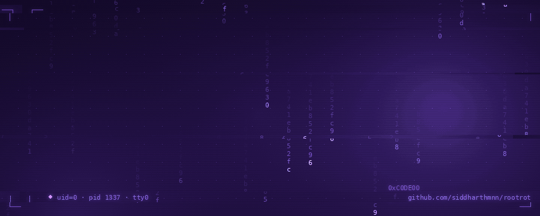
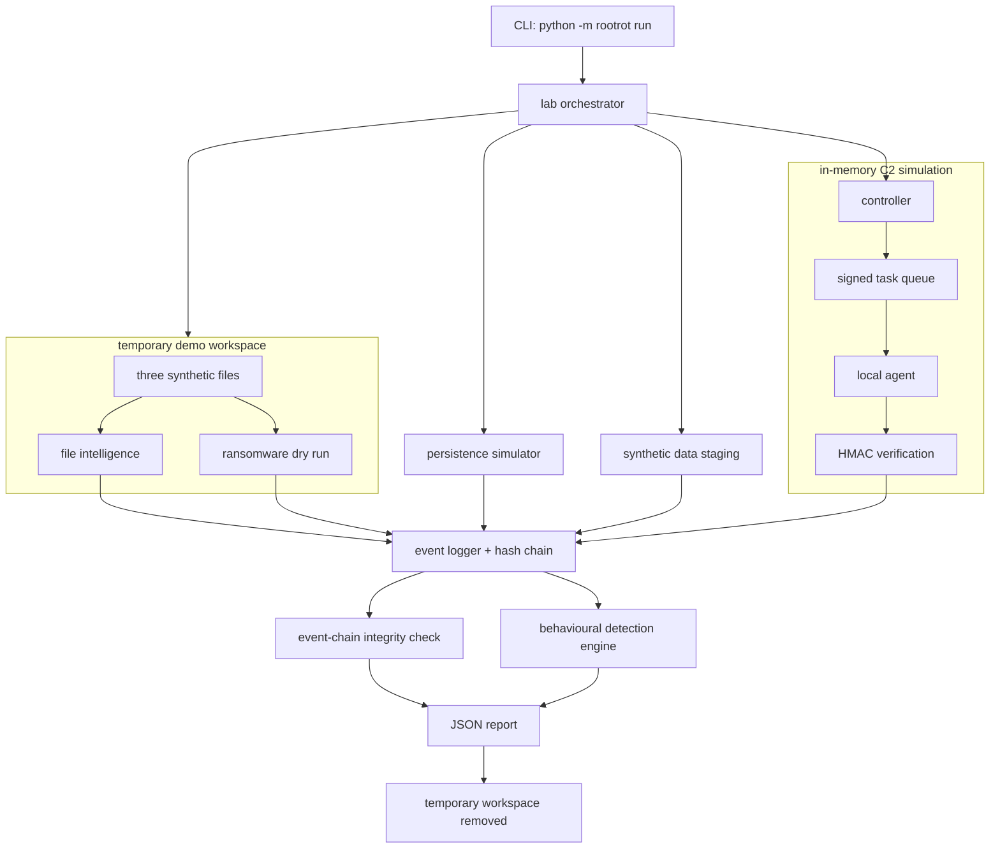
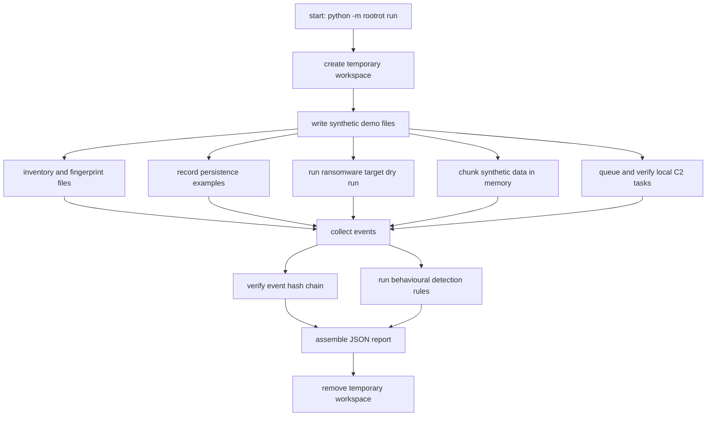
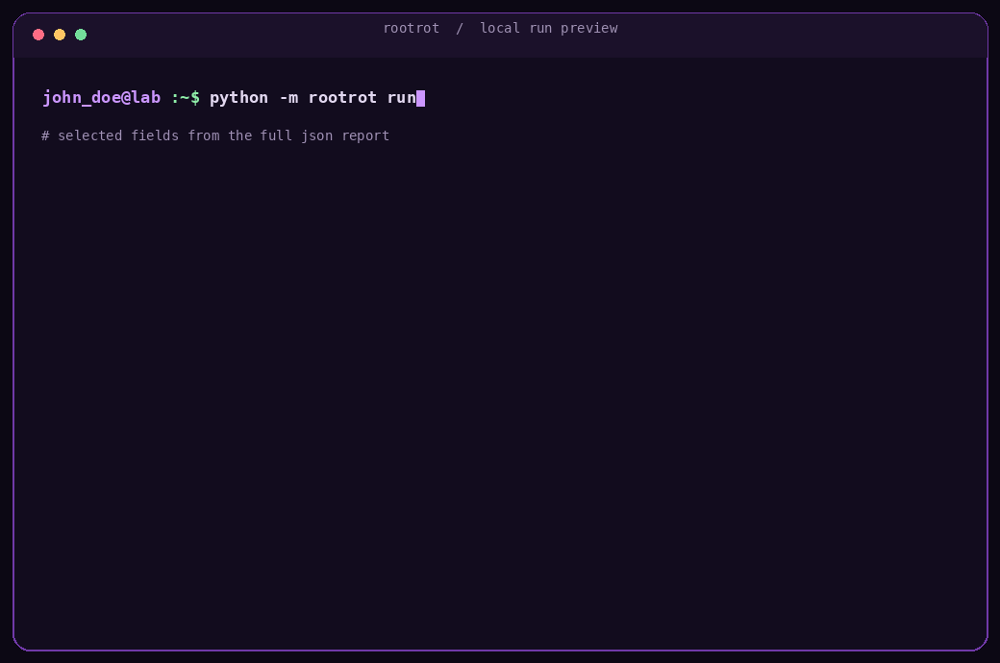

<p align="center">
  
</p>

<p align="center">
  <a href="https://www.python.org/">
    
  </a>
  
  
  
  
</p>

<p align="center">
  <em>a local, non-destructive python lab for modelling malware behaviours and inspecting the telemetry they produce.</em>
</p>

---

## table of contents

- [overview](#overview)
- [what it demonstrates](#what-it-demonstrates)
- [architecture](#architecture)
- [execution workflow](#execution-workflow)
- [mitre att&ck concepts](#mitre-attck-concepts)
- [project structure](#project-structure)
- [installation and usage](#installation-and-usage)
- [terminal demo](#terminal-demo)
- [understanding the output](#understanding-the-output)
- [testing](#testing)
- [security scope](#security-scope)
- [roadmap](#roadmap)
- [references](#references)
- [license](#license)

## overview

`rootrot` is a modular Python demo that models a small set of malware-related behaviours in an isolated environment, then analyses the events those simulations produce.

The idea is to make the flow easier to follow: inspect a controlled set of files, model selected attacker behaviours, collect events, check the event trail, and run simple detection rules. The program is deliberately a simulator. It does not attempt to operate as real malware.

## what it demonstrates

Each module focuses on one behaviour, the reason an attacker might use it, and the signals a defender could investigate.

| module | what the behaviour means | what rootrot actually does |
|---|---|---|
| **file intelligence** | Malware and security tools may enumerate files and inspect their properties to decide what to target or investigate. | Walks the temporary demo workspace, calculates SHA-256 fingerprints, records file metadata, and estimates Shannon entropy. It skips symlinks and rejects paths outside the workspace. |
| **persistence simulation** | Malware may try to run again after a reboot or user logon. | Records examples such as Run keys, scheduled tasks, Linux autostart entries, and service registration as hypothetical actions. It does not create or modify any of them. |
| **C2 simulation** | A command-and-control design lets an operator issue tasks to an agent. | Uses an in-memory queue, an allowlist of three demo actions, and HMAC-SHA256 signatures. The controller and agent run in the same process; there are no sockets or remote commands. |
| **ransomware dry run** | Ransomware often searches for files that match its targeting rules before attempting impact. | Finds selected file extensions in the temporary workspace and reports which files would be candidates. It does not encrypt, rename, overwrite, or delete files. |
| **data staging simulation** | Collected data may be prepared or grouped before a later transfer. | Splits synthetic bytes into in-memory chunks and calculates a SHA-256 digest for each chunk. Nothing is written to a staging directory or transmitted. |
| **detection engine** | Defenders correlate behaviour across events rather than relying on one filename or indicator. | Applies a small set of deterministic rules to the events created during the run and returns findings in the JSON report. |
| **event logger** | Security telemetry needs an audit trail that can be checked for unexpected changes. | Stores events in memory and links each event to the previous one with a SHA-256 hash. `verify_integrity()` checks the chain; this is tamper-evident checking, not a trusted remote log store. |

### a note on entropy

Entropy is a statistical property, not a malware verdict. Compressed, encrypted, and perfectly legitimate files can all have high entropy. In this demo it is included as one file-inspection signal, not as a standalone detection rule.

## architecture

The CLI calls the lab orchestrator. The orchestrator creates a temporary workspace, runs each simulator, collects events, and builds one JSON report.



The event log is held in memory for the duration of the run. The report is printed to standard output; the program does not silently save it to a file.

## execution workflow

This is the order used by `run_lab()`:



## mitre att&ck concepts

The table below is a learning cross-reference, not a claim that `rootrot` implements the corresponding ATT&CK techniques. Some modules model only a small part of a technique, and others are intentionally too constrained to map directly.

| rootrot module | related ATT&CK concept | relationship and limitation |
|---|---|---|
| file intelligence | [T1083 — File and Directory Discovery](https://attack.mitre.org/techniques/T1083/) | The inventory walks a small temporary directory. It does not enumerate a real user's home directory, mounted volumes, or network shares. |
| persistence simulation | [T1547 — Boot or Logon Autostart Execution](https://attack.mitre.org/techniques/T1547/) and [T1053 — Scheduled Task/Job](https://attack.mitre.org/techniques/T1053/) | The module logs hypothetical examples related to autostart and task scheduling. It does not create registry keys, scheduled tasks, startup entries, or services. |
| data staging simulation | [T1074 — Data Staged](https://attack.mitre.org/techniques/T1074/) | The module demonstrates chunking and per-chunk metadata only. It keeps synthetic bytes in memory; it does not create a local staging location or prepare real collected data. |
| C2 simulation | no direct technique mapping | The controller and agent exchange allowlisted tasks through an in-memory Python queue. There is no network protocol, external server, or remote command execution. |
| ransomware dry run | [T1486 — Data Encrypted for Impact](https://attack.mitre.org/techniques/T1486/) is **not implemented** | The simulator only identifies candidate files. It performs no encryption or destructive impact. The link is included to distinguish the real ATT&CK technique from this safe dry run. |

Use the linked MITRE pages for the full technique definitions, platforms, sub-techniques, and detection guidance. The mappings here are intentionally conservative.

## project structure

```text
rootrot/
│
├── rootrot/                         # application package
│   ├── __init__.py                  # package version
│   ├── __main__.py                  # python -m rootrot entry point
│   ├── cli.py                       # command-line interface
│   ├── events.py                    # in-memory event log and hash chain
│   ├── file_intel.py                # file inventory, hashes, and entropy
│   ├── c2_simulator.py              # local controller, queue, and agent
│   ├── persistence_simulator.py     # hypothetical persistence events
│   ├── ransomware_simulator.py     # non-destructive file targeting dry run
│   ├── staging_simulator.py        # synthetic in-memory chunking
│   ├── detection.py                 # event correlation and rule-based findings
│   └── lab.py                       # temporary workspace and orchestration
│
├── tests/                           # unit and integration tests
│   ├── test_events.py
│   ├── test_file_intel.py
│   ├── test_c2_simulator.py
│   └── test_lab.py
│
├── assets/                          # README animations
│   ├── .gitkeep                      # keeps the folder in Git
│   ├── rootrot-banner.gif
│   └── terminal-demo.gif
│
├── pyproject.toml                   # package metadata and CLI entry point
├── .gitignore                       # local and generated files to ignore
└── README.md                        # project documentation
```

## installation and usage

### requirements

- Python **3.10 or newer**
- Git
- No third-party Python runtime packages are required

### clone the repository

```bash
git clone https://github.com/siddharthmnn/rootrot.git
cd rootrot
```

### create a virtual environment

**Ubuntu / WSL / macOS**

```bash
python3 -m venv .venv
source .venv/bin/activate
```

**Windows PowerShell**

```powershell
py -m venv .venv
.venv\Scripts\Activate.ps1
```

### install the package

```bash
python -m pip install -e .
```

The editable install makes the `rootrot` command available in the active virtual environment.

### run the lab

```bash
python -m rootrot run
```

Or use the installed command:

```bash
rootrot run
```

Both commands run the same local simulation and print the full JSON report to the terminal. To save a copy yourself, use shell redirection:

```bash
python -m rootrot run > rootrot-report.json
```

## terminal demo

The animation below shows selected fields from a successful local run. It is a compact view of the report; the command above prints the complete JSON output.

<p align="center">
  
</p>

## understanding the output

A validated run with the current demo data produced the following summary:

| report field | observed value | what it represents |
|---|---:|---|
| `file_inventory` | 3 entries | the three synthetic files created for the demo |
| `persistence_simulation` | 4 examples | hypothetical persistence locations logged, not written |
| `c2_simulation` | 3 tasks | `status`, `inventory`, and `hash_file` handled locally |
| `ransomware_simulation.targets` | 3 candidates | files matching the dry-run extension list |
| `staging_simulation.chunk_count` | 6 chunks | chunks made from synthetic bytes held in memory |
| `detections` | 4 findings | rule matches from the generated event stream |
| `event_count` | 25 events | events emitted during this run |
| `event_log_integrity` | `true` | the in-memory hash chain passed verification |

The exact counts can change if the demo files, rules, or simulation settings change.

The current detection rules demonstrate four signals:

- `persistence_indicator` — hypothetical persistence actions were logged.
- `data_staging_indicator` — synthetic data was chunked in memory.
- `ransomware_like_file_selection` — candidate files were found by the dry-run scanner.
- `repeated_beaconing` — three local, in-memory beacon events were recorded. These are not network heartbeats.

These are teaching signals from a small rule set, not a verdict that a real machine is infected. The rules are deterministic and can produce false positives when applied to real telemetry.

## testing

The test suite uses Python's built-in `unittest` module.

Run all tests from the repository root:

```bash
python -m unittest discover -s tests -v
```

The current suite contains **23 tests** covering:

- event creation, hash-chain validation, and tamper detection;
- file metadata, SHA-256, entropy, size limits, and path boundaries;
- C2 task allowlisting, HMAC verification, and workspace restrictions;
- lab integration and non-destructive simulation behaviour.

The 23 tests passed in the local validation run used to prepare this README. Run them again after making changes or before relying on a new build.

## security scope

`rootrot` is deliberately constrained to a local demonstration. Each run:

- creates three synthetic files inside a temporary directory;
- inspects only files inside that workspace;
- removes the temporary workspace when the run finishes;
- keeps its event log, C2 queue, and staged bytes in memory;
- uses a random per-run secret to authenticate simulated C2 tasks.

It does **not**:

- make network connections or contact an external C2 server;
- execute shell commands or launch additional processes;
- create real persistence mechanisms or modify operating-system settings;
- encrypt, rename, overwrite, or delete user files;
- collect credentials, personal files, or other real user data;
- transmit staged data outside the process.

The project is not an antivirus product, endpoint detection platform, or deployable malware sample. Its detection rules are intentionally small and are intended to make the relationship between simulated actions and generated telemetry understandable.

## roadmap

The current version keeps the demo deliberately small: one temporary workspace, a handful of behaviour simulators, an in-memory event trail, and a set of deterministic detection rules.

A few areas worth building on next:

- **Configurable runs:** choose which simulations execute and adjust the synthetic inputs without editing the source.
- **More detection coverage:** add rules for additional event combinations, then test missing, repeated, and out-of-order events.
- **Report export:** add an explicit option to write the JSON report to a chosen path while keeping terminal output as the default.
- **Automated checks:** run the existing `unittest` suite on pushes and pull requests with GitHub Actions.

## references

- [MITRE ATT&CK](https://attack.mitre.org/) — knowledge base of adversary tactics and techniques.
- [T1083: File and Directory Discovery](https://attack.mitre.org/techniques/T1083/)
- [T1547: Boot or Logon Autostart Execution](https://attack.mitre.org/techniques/T1547/)
- [T1053: Scheduled Task/Job](https://attack.mitre.org/techniques/T1053/)
- [T1074: Data Staged](https://attack.mitre.org/techniques/T1074/)
- [T1486: Data Encrypted for Impact](https://attack.mitre.org/techniques/T1486/) — referenced as a contrast; not implemented by `rootrot`.
- [Python documentation](https://docs.python.org/3/) — language and standard-library reference.

## license

This project is licensed under the MIT License. See the [LICENSE](LICENSE) file for details.

---

<p align="center">
  <sub>built as a controlled, hands-on demonstration for understanding malware behaviour and the defensive analysis of its signals.</sub>
</p>
